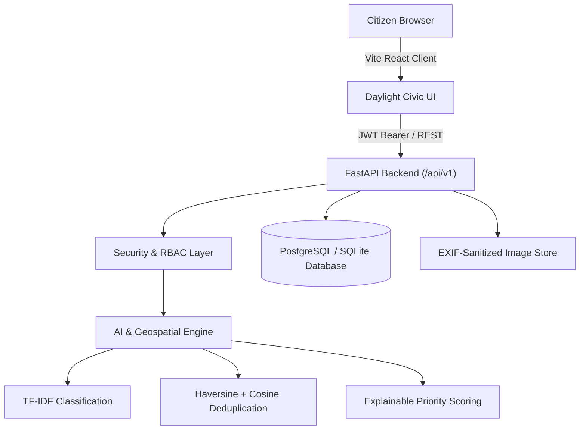

# CIVIC PULSE
### AI-Powered Civic Issue Reporting, Intelligence, Prioritization & Resolution Platform
**UI/UX Design System:** *"Daylight Civic"* (Warm day theme, accessible, mobile-first)

---

## 1. Executive Summary & Vision

**CIVIC PULSE** connects citizens and authorized municipal personnel through a transparent, explainable public-issue resolution platform. Citizens report civic infrastructure hazards (potholes, burst pipelines, broken streetlights, overflowing waste), upload photographs, pin locations on interactive maps, and track the status journey of their complaints in real time.

The platform uses statistical NLP classification, multi-signal duplicate detection, explainable priority scoring, and geodesic density analytics to help cities organize and resolve complaints efficiently.

> **Academic & Civic Integrity Notice:** CIVIC PULSE is a transparent decision-support system. It is not an officially connected municipal department unless authorized integrations are configured. It never fabricates metrics, claims false government affiliations, or hides model failure states.

---

## 2. Technology Stack

- **Frontend**: React 18, TypeScript, Vite, React Router 6, Tailwind CSS ("Daylight Civic" color tokens), Leaflet & React-Leaflet, OpenStreetMap, Recharts, Lucide Icons.
- **Backend**: Python 3.12, FastAPI, Pydantic v2, SQLAlchemy 2.0, Alembic, PostgreSQL / SQLite engine with Haversine spatial math, Pytest, PyJWT, bcrypt.
- **AI / Data**: scikit-learn (`TfidfVectorizer`, multinomial `LogisticRegression`), NumPy, Pandas, Pillow (EXIF metadata sanitization).
- **Security**: Strict server-side RBAC, EXIF stripping, sliding-window rate limiting, ORM parameterization, location coordinate anonymization.

---

## 3. System Architecture & Workflows

### 3.1 Architecture Overview


### 3.2 State Machine Resolution Pipeline
```text
[SUBMITTED] ---> [UNDER_REVIEW] ---> [ASSIGNED] ---> [IN_PROGRESS] ---> [RESOLVED] ---> [CLOSED]
       |                |                                                  ^
       |                +--------> [NEEDS_INFORMATION]                     | (Citizen Reopen)
       +--------> [REJECTED]                                               +------------------+
```

---

## 4. Key AI Capabilities & Actual Evaluation Results

| AI Feature | Methodology | Evaluation Metric / Output |
| :--- | :--- | :--- |
| **Issue Classification** | Unigram + bigram TF-IDF with multinomial Logistic Regression & rule-based fallback | **58.33% Accuracy**, **0.5708 Macro F1** on stratified 25% held-out test split. Confidence $< 0.65$ routes to human staff review. |
| **Duplicate Detection** | Multi-signal composite: $50\%$ text similarity (Jaccard + TF-IDF) + $30\%$ Haversine proximity ($< 150$m) + $20\%$ category match | Flags nearby matching complaints to prevent duplicate work orders without merging distinct issues. |
| **Priority Scoring** | Transparent 5-factor weighted formula: Safety ($35\%$), Severity ($25\%$), Age ($20\%$), Accessibility ($10\%$), Duplicates ($10\%$) | Outputs explainable reasons and displays immediate emergency dispatch guidance (112 / 911) if danger triggers. |

---

## 5. Quick Start & Installation

### 5.1 Prerequisites
- Python 3.12+ (or `uv` package manager)
- Node.js 18+ and `npm`

### 5.2 Backend Setup
```bash
# Navigate to backend directory
cd backend

# Create virtual environment and install dependencies
uv venv .venv --python 3.12
.\.venv\Scripts\activate
uv pip install -r requirements.txt   # or uv pip install fastapi uvicorn ...

# Run AI training script (compiles model bundle and saves evaluation metrics)
python -m app.ai.train

# Seed database with realistic demo accounts and sample reports
python -m app.seeds.seed_data

# Run backend automated tests (16 tests, 100% passing)
pytest -v

# Start FastAPI server
uvicorn app.main:app --reload --port 8000
```
Backend API will be running at `http://localhost:8000` with interactive docs at `http://localhost:8000/docs`.

### 5.3 Frontend Setup
```bash
# Navigate to frontend directory
cd frontend

# Install dependencies
npm install

# Build production bundle
npm run build

# Start development server
npm run dev
```
Open `http://localhost:5173` in your browser.

---

## 6. One-Click Demo Accounts

| Role | Email | Password | Access Rights |
| :--- | :--- | :--- | :--- |
| **Citizen** | `citizen@civicpulse.local` | `DemoCitizen123!` | Submit reports, upload photos, pin map, track status, reopen resolved issues. |
| **Municipal Staff** | `staff@civicpulse.local` | `DemoStaff123!` | Operational queue, triage, assign field units, update status with resolution notes. |
| **Administrator** | `admin@civicpulse.local` | `DemoAdmin123!` | Manage user roles, configure categories, inspect audit logs, system health. |

*(Demo accounts can be auto-filled with 1 click on the Sign In page)*

---

## 7. Automated Test Results

The backend contains automated tests verifying unit calculations, security boundaries, and API workflows:
- **Geospatial Tests**: Haversine distance accuracy, privacy coordinate rounding, grid clustering.
- **AI Tests**: Normalization, keyword fallback, ML probability prediction, priority emergency escalation, text similarity, duplicate candidate detection.
- **Workflow Tests**: Permitted and prohibited status transitions; citizen cannot resolve own report.
- **Security & RBAC Tests**: Citizen cannot access staff/admin routes (403 Forbidden), invalid tokens rejected (401 Unauthorized), role elevation via registration rejected.

**Result**: `16 passed in 5.68s` (0 failures).

---

## 8. Technical Interview Preparation (25 Key Questions & Answers)

<details>
<summary><strong>1. Why did you choose a service-oriented modular monolith over microservices?</strong></summary>
A modular monolith with clear service boundaries (Reports, AI, Geo, Workflow, Auth) provides strong transactional consistency across state transitions while avoiding distributed transaction complexity, network latency, and operational overhead typical of early-stage systems.
</details>

<details>
<summary><strong>2. How is Role-Based Access Control (RBAC) enforced?</strong></summary>
RBAC is enforced server-side on every protected endpoint using FastAPI dependency injection (`get_current_staff_or_admin`, `get_current_admin`). Roles are encoded in signed JWT tokens, and user accounts are validated against the database on each request.
</details>

<details>
<summary><strong>3. Can a citizen elevate their role through the registration API?</strong></summary>
No. The registration schema ignores any client-supplied role and strictly assigns `UserRole.CITIZEN`. Role modification endpoints are restricted to verified `ADMIN` users only.
</details>

<details>
<summary><strong>4. How does the AI issue classification work?</strong></summary>
Text is normalized and vectorized using unigram and bigram TF-IDF with sublinear term scaling, followed by a multinomial Logistic Regression classifier trained on representative civic complaints across 8 categories.
</details>

<details>
<summary><strong>5. What happens if the AI classification model fails or is offline?</strong></summary>
The system gracefully falls back to a deterministic keyword-matching classifier. It never blocks report submission and marks the classification method as `rule_based_fallback`.
</details>

<details>
<summary><strong>6. How is duplicate report detection computed?</strong></summary>
A multi-signal composite score combines geodesic Haversine distance (pruning beyond 150m), Jaccard token overlap + TF-IDF cosine similarity on the descriptions, and category compatibility. Matches above 0.70 are flagged for staff review.
</details>

<details>
<summary><strong>7. Why not just merge reports automatically when duplicates are found?</strong></summary>
Automatic merging is high-risk in civic management. Two different problems (e.g. a pothole and a broken streetlight) can occur 10 meters apart. Suspected duplicates are linked for staff review rather than merged destructively.
</details>

<details>
<summary><strong>8. How is priority calculated?</strong></summary>
A transparent weighted formula evaluates public safety risk (35%), infrastructure severity (25%), time unresolved (20%), accessibility impacts (10%), and duplicate report volume (10%).
</details>

<details>
<summary><strong>9. How do you prevent civic complaints from delaying life-threatening emergencies?</strong></summary>
The priority scoring engine inspects text for extreme life hazards (e.g. live sparking wires, gas leaks) and triggers a prominent red emergency advisory notice directing citizens to contact emergency dispatch (112/911) immediately.
</details>

<details>
<summary><strong>10. How does the application protect citizen privacy on public feeds?</strong></summary>
Geographic coordinates on public listings are coarsened to 3 decimal places (~110 meters), and reporter names/emails are stripped from public responses.
</details>

<details>
<summary><strong>11. How do you secure image uploads against malware and tracking?</strong></summary>
Pillow verifies image integrity and magic bytes, discarding client MIME claims. Public derivatives are re-encoded into clean buffers, completely stripping EXIF and GPS tracking metadata, and saved with randomized UUID filenames.
</details>

<details>
<summary><strong>12. What algorithm is used for spatial distance calculations?</strong></summary>
The great-circle Haversine formula implemented in pure Python with unit tests, providing accurate distance measurements without requiring heavy GIS extensions during local development.
</details>

<details>
<summary><strong>13. How does the "Package-Tracking" status journey work?</strong></summary>
Modeled after shipping delivery steppers, it represents linear progression (Submitted &rarr; Reviewed &rarr; Assigned &rarr; In Progress &rarr; Resolved). Completed stages are highlighted, and the active stage features a gentle pulse animation.
</details>

<details>
<summary><strong>14. Can citizens mark their own complaints as resolved?</strong></summary>
No. The state machine strictly prohibits citizens from transitioning complaints to `RESOLVED` or `REJECTED`. Only authorized municipal staff can record resolution evidence and close complaints.
</details>

<details>
<summary><strong>15. What happens if a municipal worker falsely marks an issue resolved?</strong></summary>
Citizens can use the "Flag as Unresolved" button to reopen the report with mandatory explanatory feedback, resetting the status to `REOPENED` and alerting supervisory staff.
</details>

<details>
<summary><strong>16. How is rate limiting implemented?</strong></summary>
An in-memory sliding-window rate limiter tracks requests per client IP and endpoint, throttling brute force login attempts (15 req/min) and AI evaluation abuse (30 req/min).
</details>

<details>
<summary><strong>17. What password hashing standard is employed?</strong></summary>
`bcrypt` with 12 salting rounds, ensuring resistance to dictionary attacks and GPU-accelerated cracking.
</details>

<details>
<summary><strong>18. How are geospatial hotspots detected?</strong></summary>
A grid-based spatial aggregation algorithm buckets coordinates into geographic cells (approx 500m), computing centroid coordinates, report frequencies, and average severity scores.
</details>

<details>
<summary><strong>19. Why use Tailwind CSS with explicit design tokens?</strong></summary>
The "Daylight Civic" design system enforces a clean, bright aesthetic tailored for outdoor sunlight readability with WCAG 2.1 AA contrast compliance, avoiding arbitrary hardcoded colors.
</details>

<details>
<summary><strong>20. How is client-side state synchronized with the interactive map?</strong></summary>
Selecting a report pin in Leaflet pans the viewport and opens a popup summary, while selecting an item in the side panel centers the corresponding map marker.
</details>

<details>
<summary><strong>21. What happens during backend cold starts?</strong></summary>
The centralized frontend client catches network errors and HTTP 503 states, presenting friendly retry buttons and calm advisory banners without crashing or infinite spinners.
</details>

<details>
<summary><strong>22. Are audit logs protected from tampering?</strong></summary>
Audit logs are append-only. No API endpoint exists to update or delete audit events, preserving an indelible history of user registrations, role changes, and status transitions.
</details>

<details>
<summary><strong>23. How are database migrations managed?</strong></summary>
Alembic is configured alongside SQLAlchemy 2.0 models, enabling reproducible schema migrations across development SQLite and production PostgreSQL environments.
</details>

<details>
<summary><strong>24. What are the key limitations of the current system?</strong></summary>
The classification model is a statistical baseline trained on sample datasets; production deployment would benefit from continuous active learning. Image similarity is not yet factored into duplicate detection.
</details>

<details>
<summary><strong>25. What is the future technical roadmap?</strong></summary>
Offline-first PWA queueing, multilingual localization (Tamil & English), integration of satellite imagery, and automated contractor SLA escalation workflows.
</details>

---

## 9. License & Attribution
CIVIC PULSE is released under the MIT License for educational and municipal demonstration purposes.  
Map data &copy; [OpenStreetMap](https://www.openstreetmap.org/copyright) contributors.
