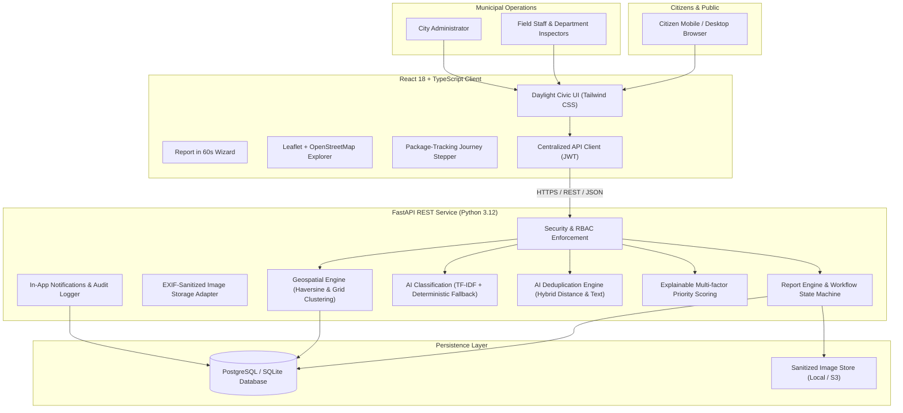
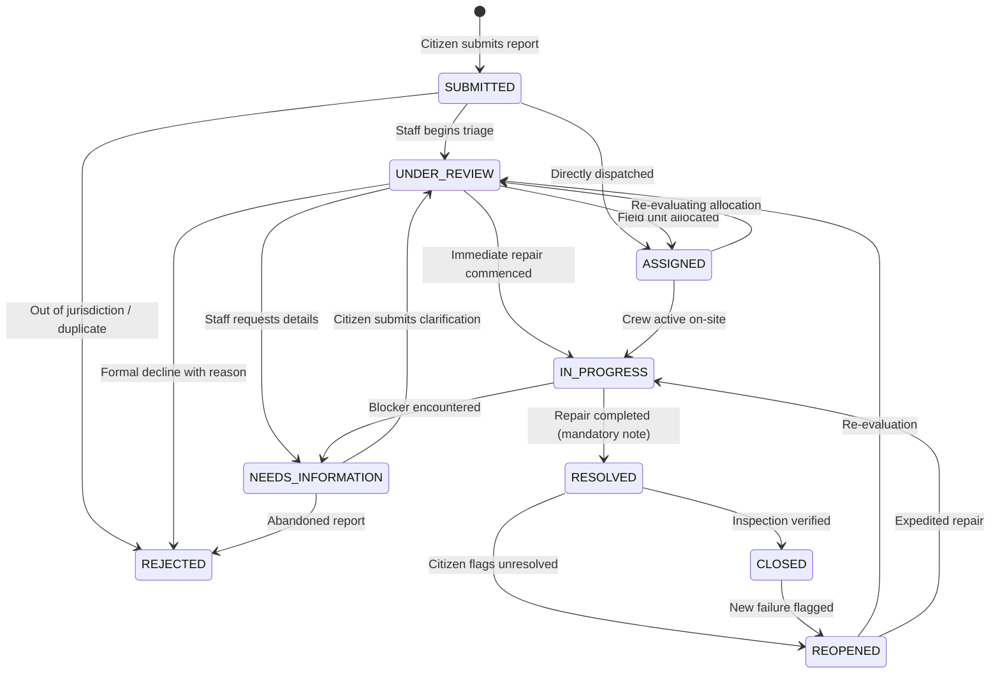
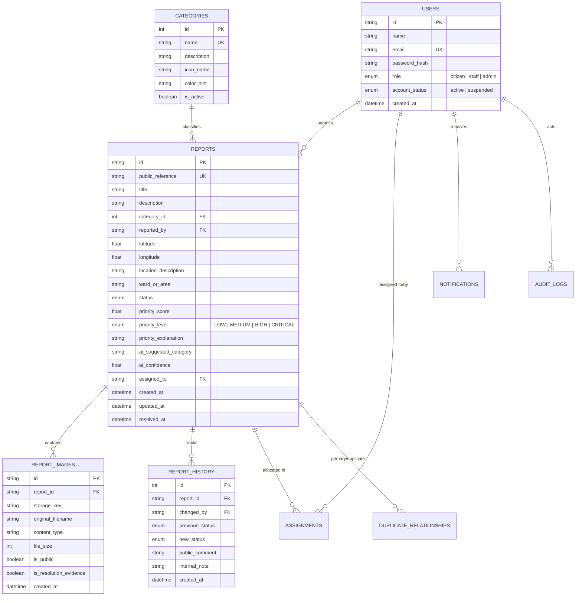

# CIVIC PULSE: System Architecture

## 1. High-Level Architecture Overview

CIVIC PULSE is designed as a service-oriented modular monolith optimized for performance, explainability, maintainability, and clean role-based boundaries.

---

## 2. Component Design

### 2.1 Frontend Client
- **Framework**: React 18 with TypeScript and Vite.
- **Styling**: "Daylight Civic" design system via Tailwind CSS with WCAG 2.1 AA compliant color tokens.
- **Mapping**: Leaflet and React-Leaflet with OpenStreetMap tile layer and custom SVG status markers.
- **Visualizations**: Recharts for transparent, direct-labeled operational KPIs.
- **State Management**: Context-based authentication state (`AuthContext`) with automatic token injection and unauthorized request interception.

### 2.2 Backend Service
- **Framework**: FastAPI with Pydantic v2 validation.
- **ORM**: SQLAlchemy 2.0 with transactional atomic commits.
- **Security**: Passwords hashed with `bcrypt` (12 rounds); access tokens signed with `PyJWT` (HS256).
- **Rate Limiting**: Sliding-window in-memory rate limiter per IP/client.
- **Image Security**: Pillow image integrity verification, re-encoding to strip EXIF and GPS tracking metadata, randomized UUID filenames.

---

## 3. Workflow State Transition Engine

Every status transition is governed by a strict state-transition matrix enforced server-side.

---

## 4. Entity-Relationship Data Model

